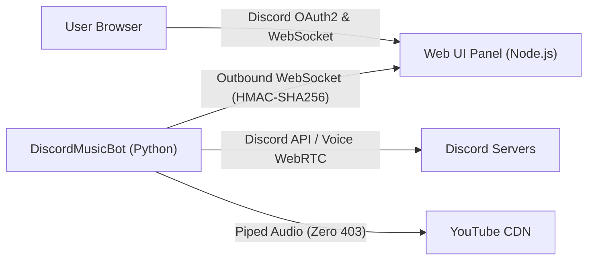
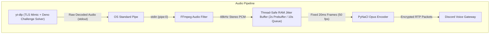

# Discord Music Bot 🎵 + Web UI Dashboard

[](https://www.python.org/downloads/)
[](https://nodejs.org/)
[](https://github.com/Rapptz/discord.py)
[](https://github.com/yt-dlp/yt-dlp)
[](https://www.docker.com/)
[](https://opensource.org/licenses/MIT)

A modern, high-performance, self-hosted Discord music bot and web management dashboard built with **Python 3 (`discord.py` 2.x)**, **FFmpeg**, **`yt-dlp`**, and **Node.js (Express + WebSocket)**.

Engineered specifically for bulletproof 24/7 reliability on cloud servers (AWS, DigitalOcean, Hetzner, GCP, Linode, Oracle Cloud) where YouTube blocks datacenter IPs. Features **Piped Audio Streaming** to permanently eliminate `HTTP 403 Forbidden` errors, automated JavaScript challenge solving via Deno, browser TLS impersonation, local high-res playlists (MP3, FLAC, OGG, WAV), YouTube selective importer, a full in-browser cookies editor, Discord OAuth2 web panel, and 1-click Docker automation for all Linux and Windows systems.

> [!NOTE]
> **Cross-Platform Compatibility:** Tested and verified on **Ubuntu 24.04 / 22.04 LTS**, **Debian**, **Arch Linux**, **Alpine**, and **Windows 10 / 11 / Windows Server**. Native Windows and Linux launchers, as well as unified multi-container Docker Compose, are fully supported out-of-the-box!

---

## Table of Contents

1. [Key Features](#key-features)
2. [Fast Start: Choose Your Platform](#fast-start-choose-your-platform)
3. [Discord Developer Portal Setup (Creating Your Bot & OAuth2)](#discord-developer-portal-setup)
   - [1. Create Application & Bot Token](#1-create-application--bot-token)
   - [2. Enable Gateway Intents](#2-enable-gateway-intents)
   - [3. Invite the Bot to Your Server](#3-invite-the-bot-to-your-server)
   - [4. Setup OAuth2 for the Web UI](#4-setup-oauth2-for-the-web-ui)
4. [Installation & Deployment](#installation--deployment)
   - [Option A: Docker Compose (Easiest & Recommended)](#option-a-docker-compose-easiest--recommended)
   - [Option B: Windows Native Setup (1-Click or Manual)](#option-b-windows-native-setup-windows-10--11--server)
   - [Option C: Linux Native Setup (Ubuntu, Debian, Arch, CentOS)](#option-c-linux-native-setup)
5. [Web UI Dashboard Overview](#web-ui-dashboard-overview)
   - [Live Playback & Interactive Seek Slider](#live-playback--interactive-seek-slider)
   - [YouTube to Local Playlist Importer & Selective Downloader](#youtube-to-local-playlist-importer--selective-downloader)
   - [YouTube Cookies Viewer & Clean-Export Method](#youtube-cookies-viewer--clean-export-method)
   - [Bot Supervisor Control & Live Logs](#bot-supervisor-control--live-logs)
   - [Web UI & Bot Settings Editor](#web-ui--bot-settings-editor)
6. [Role-Based Access Control (RBAC)](#role-based-access-control-rbac)
7. [Audio Engine Architecture](#audio-engine-architecture)
   - [Piped Streaming (Zero 403 Forbidden Errors)](#piped-streaming-zero-403-forbidden-errors)
   - [Multi-Client Strategy & Mobile Client Fallback](#multi-client-strategy--mobile-client-fallback)
   - [Thread-Safe RAM Jitter Buffer](#thread-safe-ram-jitter-buffer)
   - [Exporting `cookies.txt` (Preventing Token Expiration)](#exporting-cookiestxt-how-to-prevent-cookies-from-expiring)
8. [Bot Discord Commands Reference](#bot-discord-commands-reference)
9. [Complete Configuration Reference](#complete-configuration-reference)
   - [Bot Configuration (`config.txt`)](#bot-configuration-configtxt)
   - [Web UI Configuration (`.env`)](#web-ui-configuration-env)
10. [Production 24/7 Hosting (Reverse Proxy & Services)](#production-247-hosting-reverse-proxy--services)
    - [Apache 2.4 Reverse Proxy](#apache-24-reverse-proxy)
    - [Nginx Reverse Proxy](#nginx-reverse-proxy)
    - [Caddy Reverse Proxy](#caddy-reverse-proxy)
    - [Linux systemd Service Configuration](#linux-systemd-service-configuration)
11. [Troubleshooting & FAQ](#troubleshooting--faq)
12. [Developer & Community](#developer--community)

---

## Key Features

- **Piped Audio Streaming (`YTDLPPipeAudio`)**: Eliminates `HTTP error 403 Forbidden` by streaming audio data directly from `yt-dlp` into FFmpeg's `stdin`. FFmpeg makes **zero direct HTTP requests** to YouTube's CDN.
- **Modern Responsive Web UI**: Discord-themed dark mode interface with sticky sidebar, real-time live playback progress, seek slider, and volume control.
- **YouTube to Local Playlist Importer**: Paste any YouTube video or playlist link, preview every song, uncheck unwanted tracks with a one-click checklist, and download directly to high-quality local MP3 with server cookie authentication.
- **In-Browser YouTube Cookies Editor**: Safely view, edit, paste, or upload Netscape `cookies.txt` with zero vertical/horizontal scrolling, auto-resizing canvas, and privacy masking.
- **Discord OAuth2 Login**: Users log in securely with their Discord accounts; permissions are automatically mapped to Server Owner, Admin, DJ, and Member roles.
- **Multi-Client Strategy & Mobile Fallback**: Bypasses YouTube's "Sign in to confirm you're not a bot" challenge on datacenter IPs by querying Android, iOS, mobile web, and desktop endpoints with automated cookie-less fallback.
- **Built-In RAM Jitter Buffer (`BufferedAudioSource`)**: Maintains a 2-second pre-buffer and 10-second memory queue, pacing 20ms audio packets to eliminate jitter, stuttering, and fast-forward distortion.
- **Dual Discord Interface**: Full support for both **Discord Slash Commands** (`/play`, `/skip`, `/queue`) and traditional **prefix commands** (`!play`, `!skip`).
- **Live Discord Presence / Status**: Displays custom idle status when quiet, dynamically updates to *"Listening to: [Song Title]"* during playback, and reverts cleanly.
- **Local Audio Playlists Engine**: Scans nested directories for MP3, FLAC, OGG, and WAV files, parsing ID3 metadata, album art, and track durations automatically.
- **Supervisor Process Control (`launcher.py`)**: Web-based supervisor allows bot owners to start, stop, restart, view system metrics, and inspect live log streams in real-time.
- **Cross-Platform**: Runs on Docker, Linux, macOS, and Windows 10/11 natively.

---

## Fast Start: Choose Your Platform

| Platform / Method | Skill Level | Setup Time | Quick Launch Command |
|---|---|---|---|
| 🐳 **Docker Compose** | Beginner (Recommended) | 2 minutes | `docker compose up -d` |
| 🪟 **Windows Native** | Beginner / Power User | 3 minutes | Double-click `start.bat` |
| 🐧 **Linux Native** | Power User / VPS Admin | 3 minutes | `./start.sh` |
| 🌐 **24/7 Linux Server** | System Administrator | 5 minutes | `systemd` (Bot) + `pm2` (Web UI) |

---

## Discord Developer Portal Setup

Before running the application, create your bot on Discord:

### 1. Create Application & Bot Token
1. Open the [Discord Developer Portal](https://discord.com/developers/applications).
2. Click **New Application** in the top right, name your bot (e.g. `MusicBot`), and agree to the terms.
3. In the left sidebar, click **Bot**:
   - Under the username, click **Reset Token** to generate your bot token.
   - **Copy and securely store this token** (you will paste this into `config.txt` or Docker environment).

### 2. Enable Gateway Intents
Scroll down on the **Bot** page to **Privileged Gateway Intents**:
- ✅ Enable **Message Content Intent** (Required for prefix command fallback).
- ✅ Enable **Server Members Intent** (Required for permission hierarchy lookups).
- Click **Save Changes**.

### 3. Invite the Bot to Your Server
1. Click **OAuth2** &rarr; **URL Generator** in the left sidebar.
2. Under **Scopes**, select:
   - `bot`
   - `applications.commands`
3. Under **Bot Permissions**, select:
   - **Text Permissions**: *Send Messages*, *Embed Links*, *Attach Files*, *Read Message History*, *Use External Emojis*
   - **Voice Permissions**: *Connect*, *Speak*, *Use Voice Activity*, *Priority Speaker*
4. Copy the **Generated URL** at the bottom, paste it into your browser, choose your server, and click **Authorize**.

### 4. Setup OAuth2 for the Web UI
1. In your application, navigate to **OAuth2** &rarr; **General**.
2. Click **Add Redirect** under **Redirects**:
   - For local development: `http://localhost:5000/auth/discord/callback`
   - For public domain: `https://panel.yourdomain.com/auth/discord/callback`
3. Copy your **Client ID**.
4. Click **Reset Secret** to generate and copy your **Client Secret** (you will paste these into the Web UI `.env`).

### 5. Find Your Discord User ID (for Owner Superpowers)
To give yourself full administrator/owner permissions in the bot and Web UI:
1. In the Discord app, open **User Settings** (⚙️ gear icon at bottom-left).
2. Go to **Advanced** and turn **ON** **Developer Mode**.
3. Right-click your own avatar or username in any chat or member list, and click **Copy User ID**.
4. Paste this number into `PANEL_OWNER_IDS` in `config.txt`.

---

## Installation & Deployment

### Option A: Docker Compose (Easiest & Recommended)

Docker containerizes both the Python audio bot and Node.js Web UI so you don't need to manually configure dependencies.

1. **Clone the Repository**:
   ```bash
   git clone https://github.com/noxianwill/DiscordMusicBot.git
   cd DiscordMusicBot
   ```

2. **Configure Settings**:
   - Copy `config.example.txt` to `config.txt`:
     ```bash
     cp config.example.txt config.txt
     ```
     Open `config.txt` and paste your `BOT_TOKEN`, set `PANEL_ENABLED=true`, `PANEL_URL=ws://web:5000/agent`, and choose a shared `PANEL_SECRET`.
   - Copy `web/.env.example` to `web/.env`:
     ```bash
     cp web/.env.example web/.env
     ```
     Paste your Discord `DISCORD_CLIENT_ID`, `DISCORD_CLIENT_SECRET`, and set `AGENT_SECRET` to match `PANEL_SECRET`.

3. **Start the Stack**:
   ```bash
   docker compose up -d
   ```
4. Open `http://localhost:5000` (or your server IP) in your browser!

---

### Option B: Windows Native Setup (Windows 10 / 11 / Server)

#### Prerequisites (Installed in 1 command)
Open **PowerShell as Administrator**:
```powershell
winget install Python.Python.3.11 OpenJS.NodeJS.LTS Gyan.FFmpeg DenoLand.Deno Git.Git
```
*(Restart your terminal after installation so environment paths update).*

#### Running with 1-Click Batch Script:
1. Clone the repository or download as ZIP:
   ```cmd
   git clone https://github.com/noxianwill/DiscordMusicBot.git
   cd DiscordMusicBot
   ```
2. Copy `config.example.txt` to `config.txt` and fill your bot token.
3. Copy `web\.env.example` to `web\.env` and fill your Discord Client ID/Secret.
4. Double-click **`start.bat`** in the repository root. The script automatically sets up the Python virtual environment, installs dependencies, and launches both processes!

---

### Option C: Linux Native Setup

#### 1. System Packages (Ubuntu / Debian)
```bash
sudo apt update
sudo apt install -y python3 python3-venv python3-pip nodejs npm ffmpeg curl git
# Install Deno (required for YouTube JS challenge solver)
curl -fsSL https://deno.land/install.sh | sh
sudo cp ~/.deno/bin/deno /usr/local/bin/
```

#### 2. Install Python Bot Dependencies
```bash
python3 -m venv venv
source venv/bin/activate
pip install --upgrade pip
pip install -r requirements.txt
cp config.example.txt config.txt
```

#### 3. Install Web UI Dependencies
```bash
cd web
npm install
cp .env.example .env
cd ..
```

#### 4. Run Both Processes
- Terminal 1 (Bot Supervisor):
  ```bash
  source venv/bin/activate
  python3 launcher.py
  ```
- Terminal 2 (Web UI Dashboard):
  ```bash
  cd web
  npm start
  ```

---

## Web UI Dashboard Overview

The self-hosted dashboard connects directly to the bot with zero database overhead:



### Live Playback & Interactive Seek Slider
- Displays the current song thumbnail, title, artist, and requester.
- Real-time seek progress bar with live elapsed and total duration timers.
- Play, Pause, Skip, Previous, Volume, and Loop mode controls.
- Voice channel status pill with one-click channel switching and Disconnect controls.

### YouTube to Local Playlist Importer & Selective Downloader
- Paste any YouTube video URL or full YouTube playlist URL.
- Fast metadata inspection retrieves track lists without downloading raw video bytes.
- **Interactive Track Checklist**: Select or deselect individual songs, use **Select All** / **Deselect All**, or filter tracks with real-time text search.
- Downloads directly to the selected local playlist folder as high-quality MP3 (`-x --audio-format mp3 --audio-quality 0`) using server cookies to prevent IP blocks.

### YouTube Cookies Viewer & Clean-Export Method
- View, copy, or edit the active Netscape format `cookies.txt` directly in your browser.
- **Dynamic Full-Height Canvas**: Expands automatically to contain all lines with zero horizontal and vertical scrollbars.
- **Privacy Mask**: Hidden by default with a quick toggle (`👁️ Show Cookies`).

### Bot Supervisor Control & Live Logs
- Real-time status badge (`running`, `stopped`, `crashed`, `starting`).
- Live system resource monitors (CPU usage %, RAM usage in MB, system uptime, and restart counters).
- Start, Stop, and Restart bot processes with 1 click.
- Real-time terminal log viewer with autoscroll and ANSI color formatting.

---

## Role-Based Access Control (RBAC)

The Web UI dynamically checks permissions via Discord OAuth2 and the bot's live server roles:

| Action / Capability | Server Owner (`owner`) | Administrator (`admin`) | DJ Role (`dj`) | Server Member (`user`) | Non-Member (`none`) |
|---|:---:|:---:|:---:|:---:|:---:|
| **View Now Playing & Queue** | ✅ | ✅ | ✅ | ✅ | ❌ |
| **Request Songs (YouTube / URL)** | ✅ | ✅ | ✅ | ✅ | ❌ |
| **Interactive Seek Progress** | ✅ | ✅ | ✅ | ✅ | ❌ |
| **Play, Pause, Skip, Previous** | ✅ | ✅ | ✅ | ❌ | ❌ |
| **Change Volume & Loop Mode** | ✅ | ✅ | ✅ | ❌ | ❌ |
| **Manage & Reorder Queue** | ✅ | ✅ | ✅ | ❌ | ❌ |
| **Switch Voice Channel / Disconnect**| ✅ | ✅ | ✅ | ❌ | ❌ |
| **Reload Local Playlists** | ✅ | ✅ | ❌ | ❌ | ❌ |
| **Upload Audio & Import YouTube** | ✅ | ❌ | ❌ | ❌ | ❌ |
| **Manage YouTube Cookies** | ✅ | ❌ | ❌ | ❌ | ❌ |
| **Edit Bot & Server Settings** | ✅ | ❌ | ❌ | ❌ | ❌ |
| **Start / Stop / Restart Bot** | ✅ | ❌ | ❌ | ❌ | ❌ |
| **Inspect System Logs** | ✅ | ❌ | ❌ | ❌ | ❌ |

---

## Audio Engine Architecture



### Piped Streaming (Zero 403 Forbidden Errors)
Traditional Discord bots pass raw CDN stream URLs directly from `yt-dlp` to FFmpeg. When running on cloud datacenter IPs (AWS, DigitalOcean, Hetzner, GCP), YouTube's CDN inspects incoming FFmpeg connections, detects the datacenter IP without browser TLS fingerprints, and returns `HTTP 403 Forbidden`.

This bot solves this by streaming raw audio data directly from `yt-dlp`'s standard output (`stdout`) into FFmpeg's standard input (`stdin`). **FFmpeg never makes direct HTTP requests to YouTube**, permanently eliminating CDN 403 errors.

### Multi-Client Strategy & Mobile Client Fallback
- **Mobile Client Endpoints**: The bot queries YouTube via multiple client targets (`android`, `ios`, `mweb`, `web`). Mobile clients use distinct authentication flows that are far less prone to cloud IP blocks.
- **Automated Fallback**: If cookies expire, extraction automatically retries without cookies using mobile client endpoints.

### Thread-Safe RAM Jitter Buffer
Cloud VPS connections can experience brief latency spikes when fetching DASH audio fragments from YouTube. This causes Discord's WebRTC audio clock to drift, resulting in stuttering and fast-forward distortion.
- Maintains a **2-second pre-buffer** and **10-second memory queue** (~1.9 MB).
- Delivers audio frames at a solid **50 frames per second (20ms intervals)**.
- Injects smooth silence frames during network drops to preserve audio clock alignment.

---

### Exporting `cookies.txt` (How to Prevent Cookies from Expiring)

> [!CAUTION]
> **CRITICAL: Always Use a Disposable / Burner Google Account!**  
> **NEVER** use your primary personal Google or YouTube account when exporting `cookies.txt`. If YouTube flags automated requests from a cloud datacenter IP, the linked account may face restrictions. Always create a free secondary/burner account solely for your bot.

#### The `robots.txt` Clean-Export Method (Recommended by `yt-dlp`)
YouTube's SPA desktop website runs continuous client-side JavaScript that invalidates session tokens (`SAPISID`, `__Secure-3PSID`, `LOGIN_INFO`) as you browse. To export clean, stable session cookies:

1. **Open a New Incognito / Private Window** in Chrome, Firefox, or Brave.
2. **Sign into YouTube** with your **burner account**.
3. **Navigate directly to `robots.txt` in that exact same tab**:
   ```text
   https://www.youtube.com/robots.txt
   ```
   *(Why this works: `robots.txt` is a static plain-text page. No tracking scripts or token-rotation engines load, preserving clean tokens).*
4. **Export in Netscape Format**: Open your exporter extension (e.g., [Get cookies.txt LOCALLY for Chrome](https://chromewebstore.google.com/detail/get-cookiestxt-locally/cclelndahbckbenkjhflpdbgdldlbecc) or [Firefox](https://addons.mozilla.org/firefox/addon/get-cookies-txt-locally/)) and click **Export**.
5. **Close the Incognito Window Immediately** without clicking "Log Out".
6. **Save into the Bot**: Paste or load the file directly into the Web UI's **YouTube Cookies** editor and click **Save Cookies**, or place it at `DiscordMusicBot/cookies.txt`.

---

## Bot Discord Commands Reference

| Slash Command | Text Prefix Command | Description | Permission Tier |
|---|---|---|---|
| `/play <query>` | `!play <query>` | Play audio from YouTube URL, search query, or local track | User |
| `/pause` | `!pause` | Pause currently playing track | DJ / Admin |
| `/resume` | `!resume` (`!unpause`) | Resume paused playback | DJ / Admin |
| `/skip` | `!skip` (`!s`) | Skip to the next track in queue | DJ / Admin |
| `/previous` | `!prev` (`!back`) | Play the previously played track | DJ / Admin |
| `/stop` | `!stop` | Stop playback and clear upcoming queue | DJ / Admin |
| `/seek <timestamp>` | `!seek <timestamp>` | Seek to timestamp (e.g. `1:30` or `90`) | DJ / Admin |
| `/volume <0-200>` | `!volume <0-200>` (`!vol`) | Adjust playback volume level | DJ / Admin |
| `/loop <off\|track\|queue>`| `!loop <mode>` | Set playback loop mode | DJ / Admin |
| `/queue display` | `!queue` (`!q`) | Display interactive paginated queue | User |
| `/queue shuffle` | `!shuffle` | Randomize order of upcoming tracks | DJ / Admin |
| `/queue remove <index>`| `!remove <index>` | Remove a specific track from queue | DJ / Admin |
| `/queue move <from> <to>`| `!move <from> <to>` | Move track position in queue | DJ / Admin |
| `/queue clear` | `!clear` | Clear all upcoming tracks from queue | DJ / Admin |
| `/playlist play <name>` | `!playlist play <name>` | Queue an entire local playlist folder | User |
| `/playlist list` | `!playlist list` | List all available local playlists on disk | User |
| `/playlist reload` | `!playlist reload` | Rescan local playlist folders from disk | Admin |
| `/leave` | `!leave` (`!disconnect`) | Disconnect bot from voice channel | DJ / Admin |
| `/dashboard` | `!dashboard` | Send direct link to the Web UI dashboard | User |

---

## Complete Configuration Reference

### Bot Configuration (`config.txt`)

| Parameter | Type | Default | Description |
|---|---|---|---|
| `BOT_TOKEN` | String | *Required* | Discord Bot Authentication Token |
| `COMMAND_PREFIX` | String | `!` | Prefix for legacy text commands |
| `DEFAULT_VOLUME` | Integer | `75` | Default playback volume percentage (0–200) |
| `AUTO_LEAVE_DURATION` | Integer | `300` | Seconds to wait before auto-leaving an empty voice channel |
| `PLAYLISTS_DIR` | String | `playlists` | Path to local playlist folders directory |
| `DJ_ROLE_NAME` | String | `DJ` | Discord role name required for DJ permissions |
| `YOUTUBE_AUTH_MODE` | String | `disabled` | `disabled` (cookies.txt) or `oauth` (Google Cloud) |
| `PANEL_ENABLED` | Boolean | `false` | Enable WebSocket connection to the Web UI |
| `PANEL_URL` | String | `""` | WebSocket endpoint (`wss://panel.example.com/agent`) |
| `PANEL_SECRET` | String | `""` | Shared HMAC secret (must match `AGENT_SECRET` in `.env`) |
| `PANEL_OWNER_IDS` | String | `""` | Comma-separated Discord User IDs granted Owner permissions |

### Web UI Configuration (`web/.env`)

| Parameter | Type | Default | Description |
|---|---|---|---|
| `PORT` | Integer | `5000` | Local port the Web UI server listens on |
| `HOST` | String | `127.0.0.1` | Local IP bind address (`0.0.0.0` for Docker) |
| `PUBLIC_URL` | String | `http://localhost:5000` | Canonical public URL used for OAuth2 callbacks |
| `DISCORD_CLIENT_ID` | String | *Required* | Discord Application Client ID |
| `DISCORD_CLIENT_SECRET` | String | *Required* | Discord Application Client Secret |
| `AGENT_SECRET` | String | *Required* | Shared HMAC secret (must match `PANEL_SECRET`) |
| `SESSION_PASSWORD` | String | *Required* | 32+ character random secret for iron-session encryption |
| `ALLOWED_USER_IDS` | String | `""` | Optional whitelist of Discord user IDs allowed to log in |

---

## Production 24/7 Hosting (Reverse Proxy & Services)

When hosting publicly, run the Web UI behind a TLS reverse proxy:

### Apache 2.4 Reverse Proxy
```apache
<VirtualHost *:443>
    ServerName panel.yourdomain.com

    SSLEngine on
    SSLCertificateFile /etc/letsencrypt/live/panel.yourdomain.com/fullchain.pem
    SSLCertificateKeyFile /etc/letsencrypt/live/panel.yourdomain.com/privkey.pem

    ProxyPreserveHost On
    ProxyRequests Off
    ProxyTimeout 600
    LimitRequestBody 104857600
    RequestHeader set X-Forwarded-Proto "https"

    RewriteEngine On
    RewriteCond %{HTTP:Upgrade} =websocket [NC]
    RewriteRule /(.*) ws://127.0.0.1:5000/$1 [P,L]

    ProxyPass / http://127.0.0.1:5000/
    ProxyPassReverse / http://127.0.0.1:5000/
</VirtualHost>
```

### Nginx Reverse Proxy
```nginx
server {
    listen 443 ssl http2;
    server_name panel.yourdomain.com;

    ssl_certificate /etc/letsencrypt/live/panel.yourdomain.com/fullchain.pem;
    ssl_certificate_key /etc/letsencrypt/live/panel.yourdomain.com/privkey.pem;

    client_max_body_size 100M;

    location / {
        proxy_pass http://127.0.0.1:5000;
        proxy_http_version 1.1;
        proxy_set_header Upgrade $http_upgrade;
        proxy_set_header Connection "upgrade";
        proxy_set_header Host $host;
        proxy_set_header X-Forwarded-Proto $scheme;
        proxy_read_timeout 600s;
    }
}
```

### Caddy Reverse Proxy
```caddy
panel.yourdomain.com {
    request_body {
        max_size 100MB
    }
    reverse_proxy 127.0.0.1:5000
}
```

### Linux systemd Service Configuration
Create `/etc/systemd/system/musicbot.service`:
```ini
[Unit]
Description=Discord Music Bot Service
After=network.target

[Service]
Type=simple
User=your_username
WorkingDirectory=/path/to/DiscordMusicBot
ExecStart=/path/to/DiscordMusicBot/venv/bin/python3 launcher.py
Restart=always
RestartSec=5
KillMode=mixed
TimeoutStopSec=30

[Install]
WantedBy=multi-user.target
```
Enable and start with:
```bash
sudo systemctl daemon-reload
sudo systemctl enable --now musicbot
```

---

## Troubleshooting & FAQ

### 1. `HTTP error 403 Forbidden` / `Server returned 403 Forbidden`
- **Cause**: YouTube CDN blocked direct FFmpeg connections on datacenter IPs.
- **Solution**: The bot uses `YTDLPPipeAudio` by default. Ensure a valid `cookies.txt` is present in your bot directory.

### 2. `The page needs to be reloaded` / `n challenge solving failed`
- **Cause**: Missing JavaScript engine needed by `yt-dlp` to execute YouTube's n-challenge cipher.
- **Solution**: Install Deno globally:
  ```bash
  curl -fsSL https://deno.land/install.sh | sh
  sudo cp ~/.deno/bin/deno /usr/local/bin/
  deno --version
  ```

### 3. Web UI reports "Bot Offline"
- **Cause**: Bot is not paired or `PANEL_SECRET` does not match `AGENT_SECRET`.
- **Solution**: Verify `PANEL_ENABLED=true` in `config.txt` and ensure `PANEL_SECRET` in `config.txt` matches `AGENT_SECRET` in `web/.env` character-for-character.

### 4. Discord Login Fails with "Invalid OAuth2 Redirect"
- **Cause**: The redirect URL configured in the Discord Developer Portal does not match your browser URL.
- **Solution**: Ensure `https://panel.yourdomain.com/auth/discord/callback` is added under **OAuth2 &rarr; Redirects** in the Developer Portal.

---

## Developer & Community

Created and maintained by **Walid Bouachir** ([@NoxianWill](https://github.com/noxianwill)).

- 🐙 **GitHub:** [noxianwill](https://github.com/noxianwill)
- 🐦 **Twitter / X:** [@walidbouachir](https://x.com/walidbouachir)
- 📺 **YouTube:** [@NoxianWill](https://www.youtube.com/@NoxianWill)
- 🎮 **Twitch:** [noxianwill](https://www.twitch.tv/noxianwill)
- 📷 **Instagram:** [@bouachir.walid](https://www.instagram.com/bouachir.walid)

---

## License

This project is licensed under the [MIT License](LICENSE).
